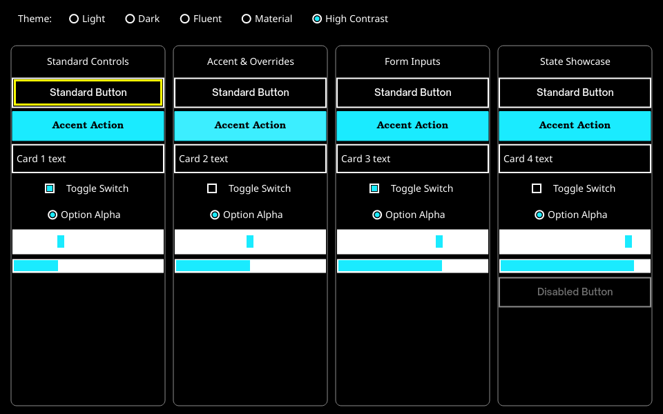
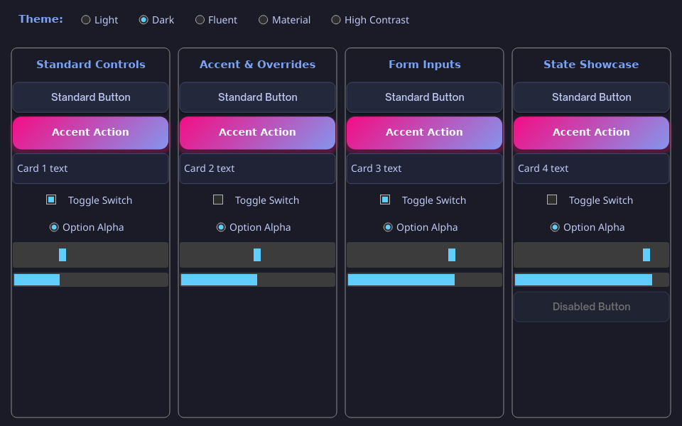

# rtk

A small tkinter-style GUI crate for Rust 1.85, edition 2021. Version 0.4 adds an
advanced styling layer (design tokens, ttk-style named styles, state maps with animated
transitions, rounded corners, shadows, gradients, fonts, CSS-like stylesheets with hot reload,
five built-in themes) on top of the unchanged basic API.

## New in 0.8
Text, Combobox, Notebook (+ `pack_forget`), Listbox select callbacks, ProgressBar bound to `Var<f64>`,
tooltips, monospace, Canvas RGBA images + colormaps, thread-safe `TkProxy`, in-app dialogs (file open/save,
typed confirmation), modern dark/light themes with accent color and card/sidebar/chip styles, and built-in icons.
See `examples/modern.rs` (`cargo run --example modern -- --screenshot modern.png`).

## Features

- Frame, Label, Button, single-line Entry, Checkbutton, and integer Scale.
- Listbox, Scrollbar, Radiobutton, Canvas, Spinbox, and ProgressBar.
- Themes: `Theme::Light` and `Theme::Dark` with automatic palette switching.
- Absolute and relative geometry placement via `tk.place` and `PlaceOpts`.
- Retained Canvas items (rect, oval, line, text) and drag gestures.
- Generational widget IDs, subtree destruction, and typed variable handles.
- Live string/integer text bindings and boolean/integer control bindings.
- Synchronous variable traces with a reentrant-notification guard.
- Pack, grid, and place layout managers with weighted tracks and anchors.
- Tab/Shift+Tab traversal; Space/Enter button activation; visible focus rings.
- Entry Unicode cluster-aware editing, clipped text, and horizontal caret scroll.
- Software rendering with cosmic-text, tiny-skia, and softbuffer.
- Headless PNG rendering and event simulation methods (`sim_*`).


Screenshots of `examples/demo.rs` on X11 after interacting with it (typed into the Entry, picked a radio button, dragged the Scale, scrolled and selected in the Listbox, drew on the Canvas, toggled the dark theme).

## Widgets

| Widget | Description |
|---|---|
| `Frame` | Container for grouping and nesting layout managers |
| `Label` | Static or variable-bound text display |
| `Button` | Clickable button with command callback |
| `Entry` | Single-line text input with caret navigation |
| `Checkbutton` | Checkbox toggling a `Var<bool>` |
| `Radiobutton` | Radio button selecting a value in a `Var<i64>` group |
| `Scale` | Integer slider bound to a `Var<i64>` |
| `Spinbox` | Incremental number spinner bound to a `Var<i64>` |
| `ProgressBar` | Horizontal progress indicator bound to `0..=100` |
| `Listbox` | Scrollable list of text items with selection |
| `Scrollbar` | Vertical scrollbar linkable to a `Listbox` |
| `Canvas` | Vector canvas supporting rect, oval, line, text, and drag events |

## Example

```rust
use rtk::{Button, Label, Opt, PackOpts, Tk};

fn main() -> Result<(), Box<dyn std::error::Error>> {
    let mut tk = Tk::new();
    tk.title("Counter");
    let root = tk.root();
    let count = tk.int_var(0);
    let label = Label::new(&mut tk, root, "")?;
    let button = Button::new(&mut tk, root, "+1")?;
    tk.config(label, Opt::TextVariableInt(count));
    tk.pack(label, PackOpts::default());
    tk.pack(button, PackOpts::default());
    tk.set_command(button, move |tk| {
        if let Some(value) = count.get(tk) {
            count.set(tk, value.saturating_add(1));
        }
    });
    tk.mainloop()
}
```

## Scrolling (0.7)

Scrolling works like tkinter: give a Canvas a `scrollregion`, then link a `Scrollbar` to it.

```rust
let c = Canvas::new(&mut tk, root, 800.0, 600.0)?;    // visible viewport
let sb = Scrollbar::new(&mut tk, root)?;
tk.canvas_scrollregion(c, 800.0, 2400.0);            // content size
tk.link_scrollbar(sb, c);                            // also works with a Listbox
tk.yview(c);                                         // (first, last) visible fractions
tk.yview_moveto(c, 0.5);
tk.yview_scroll(c, 1, ScrollUnit::Pages);            // or ScrollUnit::Units (48 px)
tk.xview(c); tk.xview_moveto(c, 0.0); tk.xview_scroll(c, 1, ScrollUnit::Units);
tk.canvas_view(c);                                   // current offset in px
```

- **Mouse wheel:** 48 px per notch. Shift+wheel scrolls horizontally. Wheeling over a scrollbar scrolls its target.
- **Touchpad:** uses exact pixel amounts (winit `PixelDelta`).
- **Scrollbar:** drag the thumb, or click the track to move a page.
- **Keyboard:** click a scrollable canvas to focus it (Tab also reaches it), then use PgUp/PgDn/Space, Home/End and the arrow keys.
- **Item positions:** items use content coordinates. Canvas click/drag callbacks get content coordinates too, so hit-testing still works after scrolling.
- **Limits:** there is no horizontal Scrollbar widget yet. Scroll horizontally with Shift+wheel or `xview_*`. Only a Canvas scrolls, not a Frame of widgets; put the scrollable content on a Canvas.

See `examples/scrolling.rs`.

## Canvas drawing (0.6)

New Canvas items for dashboards, cards, icons and sparklines. All of them work with `canvas_move`, `canvas_coords` and `canvas_delete`.

```rust
tk.canvas_create_round_rect(c, x0, y0, x1, y1, 14.0, Color::rgb(255, 255, 255));
tk.canvas_create_round_rect_outline(c, x0, y0, x1, y1, 14.0, None, Color::rgb(230, 230, 230), 1.0);
tk.canvas_create_polyline(c, &[(0.0, 30.0), (10.0, 12.0), (20.0, 18.0)], accent, 2.0); // sparkline
tk.canvas_create_polygon(c, &[(0.0, 0.0), (10.0, 0.0), (5.0, 8.0)], fill);             // icon shapes
tk.canvas_create_ring(c, x0, y0, x1, y1, color, 2.0);
tk.canvas_create_text_ex(c, x, y, "1.12", ink, 34.0, 700);                             // big bold value
let (w, h) = tk.text_size("1.12", 34.0, 700);                                         // measure for centering
```

## Timers (0.5)

tkinter-style timers run inside `mainloop`. While timers are pending, the loop sleeps until the next deadline (`ControlFlow::WaitUntil`) instead of busy-waiting. This uses winit, so it behaves the same on Windows, Linux and macOS.

```rust
let id = tk.every(1000, move |tk| { /* runs every second */ });
tk.after(3000, |tk| { /* runs once after 3 s */ });
tk.after_cancel(id);            // returns false if already gone
tk.pending_timers();
tk.sim_advance_timers(250);     // headless tests: advance the virtual clock
```

Callbacks get `&mut Tk` and may schedule or cancel timers, including themselves. If the app stalls, `every` skips missed ticks instead of firing them all at once. See `examples/timers.rs`.

## Advanced styling (0.4)

The basic options (`Opt::Bg`, `Opt::Fg`, `Opt::FontSize`, `set_theme`) still work and win
when set explicitly. On top of them:

- **Design tokens:** `tk.tokens()` / `tk.set_tokens(Tokens { palette, spacing, radius, type_scale, font_family })`.
- **Named styles like ttk:** `tk.style_configure("Accent.TButton", StyleSpec { .. })` and
  `tk.config(btn, Opt::Style("Accent.TButton".into()))`; per-widget `Opt::StyleOverride(spec)`.
- **Cascade:** theme class defaults → `TButton` → `Accent.TButton` → inherited text properties
  (colour, font) from ancestor Frames → per-widget override → state maps → basic options.
  `tk.resolved_style(id)` shows the result.
- **State maps:** `tk.style_map("TButton", State::HOVER, spec)` for hover, pressed, focused,
  disabled (`Opt::Disabled(true)`), checked and selected, with animated colour transitions
  (`transition_ms`, default 120 ms).
- **Shape and effects:** border radius, border width/colour, drop shadows, linear gradients,
  padding, margin, opacity; font family, weight, italic and size per widget.
- **Images:** `tk.load_image(png_bytes)` and `Opt::Image(id)` on Buttons and Labels.

## Styling & Stylesheets

`rtk` includes a CSS-like stylesheet engine supporting class selectors, pseudo-classes (`:hover`, `:pressed`, `:focus`, `:disabled`), gradients, shadows, and hot reloading:

```rust
tk.load_stylesheet(r#"
    TButton {
        background: #3366ff;
        color: white;
        border-radius: 6px;
        padding: 6px 14px;
        font-weight: 700;
    }

    Accent.TButton:hover {
        background: linear-gradient(135deg, #4a7dff, #7a5cff);
        box-shadow: 0 4 8 #00000066;
    }
"#)?;

// Watch file on disk for runtime hot reloading
tk.watch_stylesheet("examples/styles/custom.css");
```

## Built-in Themes

- `Theme::Light`
- `Theme::Dark`
- `Theme::Fluent` (radius 4, subtle shadows, #0067C0 accent)
- `Theme::Material` (radius 10-20 pill buttons, elevation shadows, #6750A4 accent)
- `Theme::HighContrast` (pure black/white, thick borders, yellow focus ring)





More: [Material](docs/style-material.png), [Fluent](docs/style-fluent.png). Run
`cargo run --example styling -- --theme material` or `-- --css examples/styles/custom.css`.
How this compares with ttk, CustomTkinter, Qt QSS, GTK CSS, Flutter, egui, iced, Slint and
fltk-theme: [docs/STYLING_COMPETITORS.md](docs/STYLING_COMPETITORS.md).

## tkinter vs rtk

| tkinter (Python) | rtk (Rust) |
|---|---|
| `root = tk.Tk()` | `let mut tk = Tk::new(); let root = tk.root();` |
| `lbl = tk.Label(root, text="Hi")` | `let lbl = Label::new(&mut tk, root, "Hi")?;` |
| `lbl.pack(side="left", padx=4)` | `tk.pack(lbl, PackOpts { side: Side::Left, padx: 4.0, ..Default::default() });` |
| `e.grid(row=0, column=1, sticky="ew")` | `tk.grid(e, GridOpts { row: 0, column: 1, sticky: Sticky::E \| Sticky::W, ..Default::default() });` |
| `w.place(relx=.5, rely=.5, anchor="center")` | `tk.place(w, PlaceOpts { relx: 0.5, rely: 0.5, anchor: Anchor::Center, ..Default::default() });` |
| `v = tk.IntVar(); v.set(3)` | `let v = tk.int_var(0); v.set(&mut tk, 3);` |
| `btn.config(text="New")` | `tk.config(btn, Opt::Text("New".into()));` |
| `Button(root, command=f)` | `tk.set_command(btn, \|tk\| { ... });` |
| `lb.insert(END, "x"); lb.curselection()` | `tk.listbox_insert(lb, usize::MAX, "x"); tk.listbox_curselection(lb)` |
| `c.create_oval(0,0,10,10); c.delete("all")` | `tk.canvas_create_oval(c, 0.,0.,10.,10., color); tk.canvas_clear(c);` |
| `root.mainloop()` | `tk.mainloop()?;` |

Widget handles are small `Copy` ids into an arena owned by `Tk`, so callbacks
receive `&mut Tk` instead of capturing `Rc<RefCell<..>>` widgets.

## Handle and error contract

- Widget constructors return `Result<WidgetId, RtkError>`.
- Handle-based mutations return `bool`: false means invalid/stale handle or
  incompatible configuration, with no requested mutation performed.
- Queries return `Option`; `None` means invalid/stale or inapplicable.
  `widget_rect` also returns `None` for unmanaged/invisible widgets.
- `Var::get` clones into `Option<T>`. `Var::set` returns true for a valid equal
  assignment but does not mark the UI dirty or invoke a trace.
- Widgets have `WidgetId { index: u32, gen: u32 }`. Destroying a subtree
  invalidates every descendant, clears affected input state, and frees slots.
  Reused slots have a new generation. Exhausted generations are retired.
- Destroying the root requests shutdown. `quit()` alone retains widgets.
- Variable destruction invalidates all copies; variable slots are not reused.
  Bound widgets fall back to static text or an inactive/default control value.
- Widget IDs must remain within their originating `Tk`. Cross-toolkit widget
  identity is not encoded in the two-field ID. Variables additionally check
  toolkit ownership.
- Constructors require a live Frame parent. Mixing pack and grid among siblings
  is rejected, not panicked. Frames can nest different geometry managers.

The API changed from 0.1: add `?` to constructors and `render_to_pixmap`, and
handle `Option` from variable/text queries.

## Stability and callbacks

Library runtime paths do not use panicking arena indexing or `unwrap`/`expect`.
Zero-size viewports have no hit targets and are not rendered by the backend.
`render_to_pixmap` returns an error for zero/excessive dimensions, before pixmap
allocation. Images are limited to 16 million pixels. Surface creation, resize,
buffer, and presentation failures are logged to stderr; the event loop stays
alive and retries after subsequent invalidation. Occluded windows skip drawing.

An empty font database bypasses shaping and text drawing; requested sizes use
an estimate. Widgets, borders, focus rings, and carets still render.

Commands can configure widgets, replace commands, set variables, create or
destroy subtrees (including themselves), or quit. The active callback is removed
from its slot during dispatch and restored only to the same live generation
when no replacement was installed. Reentering a running widget command is
suppressed. Variable traces use the same take/call/restore pattern. Reentrant
writes store their value, but notification of an already-notifying variable is
suppressed rather than queued; cycles therefore terminate. A trace sees the
value stored before it was called, and may change that value again.

These protections do not catch panics deliberately raised by application
callbacks, allocator exhaustion, or arbitrary bugs in platform dependencies.

## Text and geometry

Entries filter control characters and cap displayed/edited text at 64 KiB.
External StringVar assignments remain unchanged until an edit writes the
sanitized Entry text back. Cursor offsets are byte indices at cluster boundaries.
The lightweight cluster rule groups U+0300–036F combining marks, variation
selectors FE0E/FE0F, emoji skin tones, and ZWJ-linked sequences. It is not full
Unicode grapheme segmentation or bidirectional caret navigation.

Layout and padding use logical pixels. `Opt::Width` uses character units.
Font sizes must be finite and in 1–512 logical pixels. Nonfinite layout
dimensions/padding become zero; negative dimensions/padding are clamped.
Grid indices/spans are bounded to 4096 tracks, and excess requested space is
proportionally shrunk. Children remain inside their parents.

Pack order and focus order follow tree/child creation order, not reused arena
indices. Scale supports integer endpoints, including reversed/equal ranges;
dragging clamps values and arrow keys step by one. Externally assigned
out-of-range scale values are visually clamped and normalized by interaction.

## Headless testing and rendering

No display server or winit event loop is needed for layout or image output.

- `sim_resize(w, h)` sets the physical viewport size.
- `sim_mouse_move(x, y)` and `sim_click(x, y)` take logical coordinates.
- `sim_mouse_down()`, `sim_mouse_up()`, `sim_key(Key)`, and `sim_text(&str)`
  exercise the real event handlers.
- `widget_rect(id)` computes layout as necessary and returns logical geometry.
- `focused_widget()` exposes focus for tests.
- `sim_scale_factor(factor)` changes the scale for headless HiDPI tests.
- `render_to_pixmap(w, h)` returns `Result<tiny_skia::Pixmap, RtkError>`.
- `save_png(path, w, h)` returns a `Result` without window operations.

Scale defaults to 1.0; screenshot dimensions are physical pixels.
`geometry(w, h)` specifies the initial window size in logical pixels.
`mainloop()` consumes Tk and must run on the main thread.


## Build and test

```sh
cargo build --all-targets
cargo test --all-targets
cargo clippy --all-targets -- -D warnings

cargo run --example demo
cargo run --example demo -- --dark
cargo run --example demo -- --png docs/demo.png
```

## Limitations

Selection, clipboard, undo/redo, IME composition, full grapheme/bidi editing,
accessibility integration, timers, native dialogs, and multiple windows remain
future work. Rendering favors clarity over caching/performance. Backend
availability and platform-specific minimize behavior still require interactive
smoke tests on supported operating systems.


## Accessibility

Enable the optional `accesskit` feature to expose the widget tree to platform
screen readers:

```toml
rtk = { version = "0.8", features = ["accesskit"] }
```

With the feature on, rtk bridges its accessibility tree to AccessKit, which
speaks Windows UIA, macOS NSAccessibility and Linux AT-SPI (via
`accesskit_unix`). Each widget is exposed with its role (button, check box,
text input, slider, …), label, current value, numeric range, toggled state,
disabled/focused flags, logical-pixel bounds and supported actions (click,
focus, set value, increment/decrement). Screen-reader actions are routed back
to the widgets, and the tree is re-published whenever it changes.

The dependency-free `Tk::accessibility_tree()` snapshot and the
`Tk::a11y_do_action()` / `Tk::a11y_set_label()` APIs work without the feature,
so accessibility behaviour is fully testable headlessly.

## Accessibility

Enable the optional `accesskit` feature to expose the widget tree to platform
screen readers:

```toml
[dependencies]
rtk = { version = "0.8", features = ["accesskit"] }
```

With the feature on, `rtk` bridges its accessibility tree to AccessKit, which
in turn drives Windows UIA, macOS NSAccessibility, and Linux AT-SPI (via
`accesskit_unix`). Widgets expose their role, label, value, numeric range,
toggled state, disabled/focused flags, bounds, and supported actions (click,
focus, set-value, increment/decrement). Assistive-technology action requests
are dispatched back into the toolkit through `Tk::a11y_do_action`.

The headless `Tk::accessibility_tree()` snapshot works without the feature and
is what the integration tests exercise.

## License

MIT OR Apache-2.0.

The bundled font in `fonts/` (Noto Sans Regular and Bold, Copyright 2022 The Noto Project Authors) is licensed under the SIL Open Font License 1.1; see `fonts/OFL.txt`. It is the default UI font; see `rtk::fonts` for the fallback order (Noto Sans, then Arial, then the platform sans).
