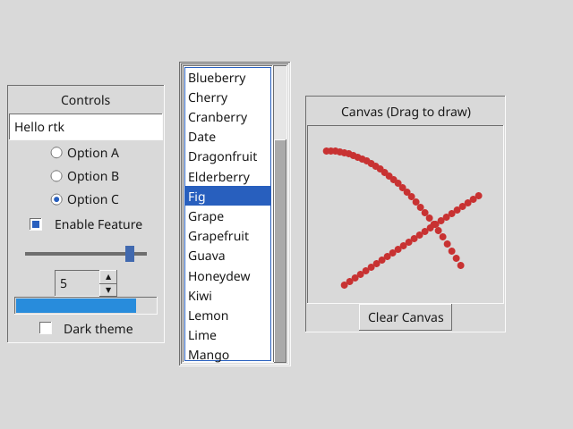
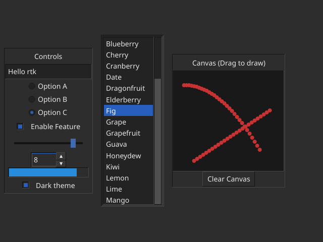

# rtk

A small tkinter-style GUI crate for Rust 1.85, edition 2021. Version 0.3 adds
canvas drawing, listboxes, scrollbars, themes, place layout, and advanced widgets.

## Features

- Frame, Label, Button, single-line Entry, Checkbutton, and integer Scale.
- Listbox, Scrollbar, Radiobutton, Canvas, Spinbox, and ProgressBar.
- Themes: `Theme::Light` and `Theme::Dark` with automatic palette switching.
- Absolute and relative geometry placement via `tk.place` and `PlaceOpts`.
- Retained Canvas items (rect, oval, line, text) and drag gestures.
- Generational widget IDs, subtree destruction, and typed variable handles.
- Live string/integer text bindings and boolean/integer control bindings.
- Synchronous variable traces with a reentrant-notification guard.
- Pack, grid, and place layout managers with weighted tracks and anchors.
- Tab/Shift+Tab traversal; Space/Enter button activation; visible focus rings.
- Entry Unicode cluster-aware editing, clipped text, and horizontal caret scroll.
- Software rendering with cosmic-text, tiny-skia, and softbuffer.
- Headless PNG rendering and event simulation methods (`sim_*`).





Screenshots of `examples/demo.rs` on X11 after interacting with it (typed into the Entry, picked a radio button, dragged the Scale, scrolled and selected in the Listbox, drew on the Canvas, toggled the dark theme).

## Widgets

| Widget | Description |
|---|---|
| `Frame` | Container for grouping and nesting layout managers |
| `Label` | Static or variable-bound text display |
| `Button` | Clickable button with command callback |
| `Entry` | Single-line text input with caret navigation |
| `Checkbutton` | Checkbox toggling a `Var<bool>` |
| `Radiobutton` | Radio button selecting a value in a `Var<i64>` group |
| `Scale` | Integer slider bound to a `Var<i64>` |
| `Spinbox` | Incremental number spinner bound to a `Var<i64>` |
| `ProgressBar` | Horizontal progress indicator bound to `0..=100` |
| `Listbox` | Scrollable list of text items with selection |
| `Scrollbar` | Vertical scrollbar linkable to a `Listbox` |
| `Canvas` | Vector canvas supporting rect, oval, line, text, and drag events |

## Example

```rust
use rtk::{Button, Label, Opt, PackOpts, Tk};

fn main() -> Result<(), Box<dyn std::error::Error>> {
    let mut tk = Tk::new();
    tk.title("Counter");
    let root = tk.root();
    let count = tk.int_var(0);
    let label = Label::new(&mut tk, root, "")?;
    let button = Button::new(&mut tk, root, "+1")?;
    tk.config(label, Opt::TextVariableInt(count));
    tk.pack(label, PackOpts::default());
    tk.pack(button, PackOpts::default());
    tk.set_command(button, move |tk| {
        if let Some(value) = count.get(tk) {
            count.set(tk, value.saturating_add(1));
        }
    });
    tk.mainloop()
}
```

## tkinter vs rtk

| tkinter (Python) | rtk (Rust) |
|---|---|
| `root = tk.Tk()` | `let mut tk = Tk::new(); let root = tk.root();` |
| `lbl = tk.Label(root, text="Hi")` | `let lbl = Label::new(&mut tk, root, "Hi")?;` |
| `lbl.pack(side="left", padx=4)` | `tk.pack(lbl, PackOpts { side: Side::Left, padx: 4.0, ..Default::default() });` |
| `e.grid(row=0, column=1, sticky="ew")` | `tk.grid(e, GridOpts { row: 0, column: 1, sticky: Sticky::E \| Sticky::W, ..Default::default() });` |
| `w.place(relx=.5, rely=.5, anchor="center")` | `tk.place(w, PlaceOpts { relx: 0.5, rely: 0.5, anchor: Anchor::Center, ..Default::default() });` |
| `v = tk.IntVar(); v.set(3)` | `let v = tk.int_var(0); v.set(&mut tk, 3);` |
| `btn.config(text="New")` | `tk.config(btn, Opt::Text("New".into()));` |
| `Button(root, command=f)` | `tk.set_command(btn, \|tk\| { ... });` |
| `lb.insert(END, "x"); lb.curselection()` | `tk.listbox_insert(lb, usize::MAX, "x"); tk.listbox_curselection(lb)` |
| `c.create_oval(0,0,10,10); c.delete("all")` | `tk.canvas_create_oval(c, 0.,0.,10.,10., color); tk.canvas_clear(c);` |
| `root.mainloop()` | `tk.mainloop()?;` |

Widget handles are small `Copy` ids into an arena owned by `Tk`, so callbacks
receive `&mut Tk` instead of capturing `Rc<RefCell<..>>` widgets.

## Handle and error contract

- Widget constructors return `Result<WidgetId, RtkError>`.
- Handle-based mutations return `bool`: false means invalid/stale handle or
  incompatible configuration, with no requested mutation performed.
- Queries return `Option`; `None` means invalid/stale or inapplicable.
  `widget_rect` also returns `None` for unmanaged/invisible widgets.
- `Var::get` clones into `Option<T>`. `Var::set` returns true for a valid equal
  assignment but does not mark the UI dirty or invoke a trace.
- Widgets have `WidgetId { index: u32, gen: u32 }`. Destroying a subtree
  invalidates every descendant, clears affected input state, and frees slots.
  Reused slots have a new generation. Exhausted generations are retired.
- Destroying the root requests shutdown. `quit()` alone retains widgets.
- Variable destruction invalidates all copies; variable slots are not reused.
  Bound widgets fall back to static text or an inactive/default control value.
- Widget IDs must remain within their originating `Tk`. Cross-toolkit widget
  identity is not encoded in the two-field ID. Variables additionally check
  toolkit ownership.
- Constructors require a live Frame parent. Mixing pack and grid among siblings
  is rejected, not panicked. Frames can nest different geometry managers.

The API changed from 0.1: add `?` to constructors and `render_to_pixmap`, and
handle `Option` from variable/text queries.

## Stability and callbacks

Library runtime paths do not use panicking arena indexing or `unwrap`/`expect`.
Zero-size viewports have no hit targets and are not rendered by the backend.
`render_to_pixmap` returns an error for zero/excessive dimensions, before pixmap
allocation. Images are limited to 16 million pixels. Surface creation, resize,
buffer, and presentation failures are logged to stderr; the event loop stays
alive and retries after subsequent invalidation. Occluded windows skip drawing.

An empty font database bypasses shaping and text drawing; requested sizes use
an estimate. Widgets, borders, focus rings, and carets still render.

Commands can configure widgets, replace commands, set variables, create or
destroy subtrees (including themselves), or quit. The active callback is removed
from its slot during dispatch and restored only to the same live generation
when no replacement was installed. Reentering a running widget command is
suppressed. Variable traces use the same take/call/restore pattern. Reentrant
writes store their value, but notification of an already-notifying variable is
suppressed rather than queued; cycles therefore terminate. A trace sees the
value stored before it was called, and may change that value again.

These protections do not catch panics deliberately raised by application
callbacks, allocator exhaustion, or arbitrary bugs in platform dependencies.

## Text and geometry

Entries filter control characters and cap displayed/edited text at 64 KiB.
External StringVar assignments remain unchanged until an edit writes the
sanitized Entry text back. Cursor offsets are byte indices at cluster boundaries.
The lightweight cluster rule groups U+0300–036F combining marks, variation
selectors FE0E/FE0F, emoji skin tones, and ZWJ-linked sequences. It is not full
Unicode grapheme segmentation or bidirectional caret navigation.

Layout and padding use logical pixels. `Opt::Width` uses character units.
Font sizes must be finite and in 1–512 logical pixels. Nonfinite layout
dimensions/padding become zero; negative dimensions/padding are clamped.
Grid indices/spans are bounded to 4096 tracks, and excess requested space is
proportionally shrunk. Children remain inside their parents.

Pack order and focus order follow tree/child creation order, not reused arena
indices. Scale supports integer endpoints, including reversed/equal ranges;
dragging clamps values and arrow keys step by one. Externally assigned
out-of-range scale values are visually clamped and normalized by interaction.

## Headless testing and rendering

No display server or winit event loop is needed for layout or image output.

- `sim_resize(w, h)` sets the physical viewport size.
- `sim_mouse_move(x, y)` and `sim_click(x, y)` take logical coordinates.
- `sim_mouse_down()`, `sim_mouse_up()`, `sim_key(Key)`, and `sim_text(&str)`
  exercise the real event handlers.
- `widget_rect(id)` computes layout as necessary and returns logical geometry.
- `focused_widget()` exposes focus for tests.
- `sim_scale_factor(factor)` changes the scale for headless HiDPI tests.
- `render_to_pixmap(w, h)` returns `Result<tiny_skia::Pixmap, RtkError>`.
- `save_png(path, w, h)` returns a `Result` without window operations.

Scale defaults to 1.0; screenshot dimensions are physical pixels.
`geometry(w, h)` specifies the initial window size in logical pixels.
`mainloop()` consumes Tk and must run on the main thread.


## Build and test

```sh
cargo build --all-targets
cargo test --all-targets
cargo clippy --all-targets -- -D warnings

cargo run --example demo
cargo run --example demo -- --dark
cargo run --example demo -- --png docs/demo.png
```

## Limitations

Selection, clipboard, undo/redo, IME composition, full grapheme/bidi editing,
accessibility integration, timers, native dialogs, and multiple windows remain
future work. Rendering favors clarity over caching/performance. Backend
availability and platform-specific minimize behavior still require interactive
smoke tests on supported operating systems.


## License

MIT OR Apache-2.0.
