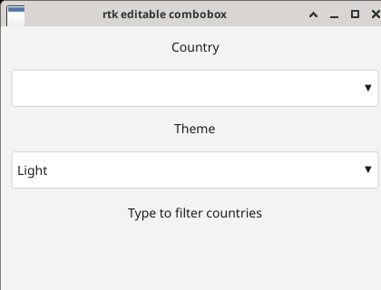

# Editable combobox

Added in 0.11. `Combobox::editable` makes a text field with a dropdown that filters as you type.
`Combobox::new` still makes the classic read-only combobox, and its behaviour is unchanged.

```rust,ignore
use rtk::Combobox;

let values = vec!["Apple".into(), "Apricot".into(), "Banana".into(), "Grape".into()];
let var = tk.int_var(-1);                     // index of the chosen value, -1 = free text
let combo = Combobox::editable(&mut tk, root, values, var)?;
tk.combobox_on_select(combo, |tk, index, text| println!("picked #{index}: {text}"));
tk.combobox_on_text_change(combo, |tk, text| println!("typing: {text}"));
```

## Behaviour

- **Typing** edits the text at the caret. The dropdown then shows the values that contain the text,
  matched case-insensitively and kept in their original order. It opens when something matches and
  closes when nothing does. The bound `Var<i64>` holds the index of the exactly matching value,
  or `-1` when nothing matches exactly.
- **Down / Up**: open the list (Down highlights the first row, Up the last), then move the
  highlight. The highlight stops at the first and last rows.
- **Enter**: picks the highlighted row. The text becomes the value, the var becomes its index, the
  list closes and `combobox_on_select` fires. With no highlight, Enter just closes the list and
  keeps the free text.
- **Escape** closes the list.
- **Mouse**: clicking the text area places the caret and does not open the list. Clicking the ▼ area
  toggles the list. Clicking a row picks it.
- **Editing** works the same as `Entry`: Left/Right/Home/End (Shift extends the selection),
  Backspace/Delete, Ctrl+A/C/X/V, undo/redo (Ctrl+Z/Y) and IME composition. Every user edit runs
  the filter again and fires `combobox_on_text_change` once.

## API

| Method | Notes |
|---|---|
| `combobox_is_editable(id)` | |
| `combobox_get_text(id)` / `combobox_set_text(id, text)` | `set_text` updates the filter and var, but does not open the list or fire callbacks |
| `combobox_get(id)` | `(var, text)`. For an editable combobox the text is the free text |
| `combobox_on_select(id, f)` | Works on both editable and read-only comboboxes |
| `combobox_on_text_change(id, f)` | Editable only |
| `combobox_get_filtered(id)` / `combobox_get_highlighted(id)` | The visible rows, and the value index of the highlighted row |
| `combobox_open(id)` / `combobox_close(id)` / `combobox_is_open(id)` | |
| `combobox_set_values(id, values)` | Also runs the filter again |

Colours come from the theme (`TCombobox` style, palette `select_bg`/`select_fg`). The dropdown in
HighContrast now uses the palette's black field colour. Before this change its white rows made the
white text unreadable.

Tests are in `tests/m011_combobox.rs`. Goldens are `m011_combobox_editable_*` and
`m011_combobox_closed_*`. The example is `examples/combobox_editable.rs`.

## Screenshot

This is `examples/combobox_editable` in a real X11 window (Xvfb with xfwm4), after typing "an" and pressing Down twice:



## Limits

- Filtering is substring-only. There is no fuzzy or prefix-ranked matching, and no inline
  autocompletion of the rest of a word.
- There is no double-click word selection, the same as `Entry`.
- The dropdown is 240 px tall at most. Rows past that are not drawn, the list does not scroll yet,
  and the same is true for read-only comboboxes.
